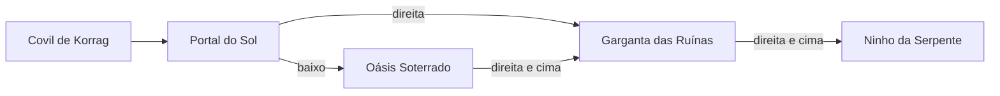

# Deserto — áreas e conexões visuais v1

Proposta visual preparada em 21/10/2026 para transformar o Deserto em um pequeno conjunto de salas exploráveis, mantendo o arco aprovado de dia → tarde → noite.

**Aprovação (21/10/2026):** Higor aprovou os quatro fundos, os nomes das áreas e a estrutura de conexões abaixo.

| Área | Função visual e de percurso | Fundo |
|---|---|---|
| Portal do Sol | Entrada horizontal, sol evidente, checkpoint e apresentação do bioma. | `desert_portal_sol_v1.png` |
| Garganta das Ruínas | Sala vertical de plataformas entre paredões e ruínas, já no entardecer. | `desert_garganta_ruinas_v1.png` |
| Oásis Soterrado | Ramificação inferior opcional com areia movediça e ponto de restauração seco → vivo. | `desert_oasis_soterrado_v1.png` |
| Ninho da Serpente | Arena horizontal larga, noturna e com silhueta limpa para os três ataques da cobra. | `desert_ninho_serpente_v1.png` |

A ligação do Oásis à Garganta forma um retorno e evita um corredor totalmente linear. As imagens são fundos sem colisão; as plataformas, ruínas, hazard e restauração permanecem em camadas separadas para o Gustavo posicionar conforme o percurso aprovado. A folha `desert-area-backgrounds-v1.png` testa a leitura do kit sobre os quatro fundos.

As quatro bases foram produzidas com o gerador de imagens integrado, usando os fundos já aprovados como referência de estilo e mantendo a região inferior menos detalhada para preservar a leitura do Kairo, dos inimigos e das plataformas.
