# Revisão visual do roadmap — 12/10/2026

Entregas locais na branch `master`, ainda sem commit. As imagens são capturas do Godot em execução, usando as cenas reais. O teste `tools/art/RoadmapArtReview.gd` não emite eventos de progresso nem grava o save.

## Marco de checkpoint — Dossel Vivo

O único checkpoint da demo ganhou raiz e pedra assentadas na linha do chão. Atravessá-lo troca o broto apagado pelo aceso, com faíscas breves e uma pulsação de luz; o visual também acompanha o estado `Activated` ao carregar a cena.

| Apagado | Ativado |
| --- | --- |
| 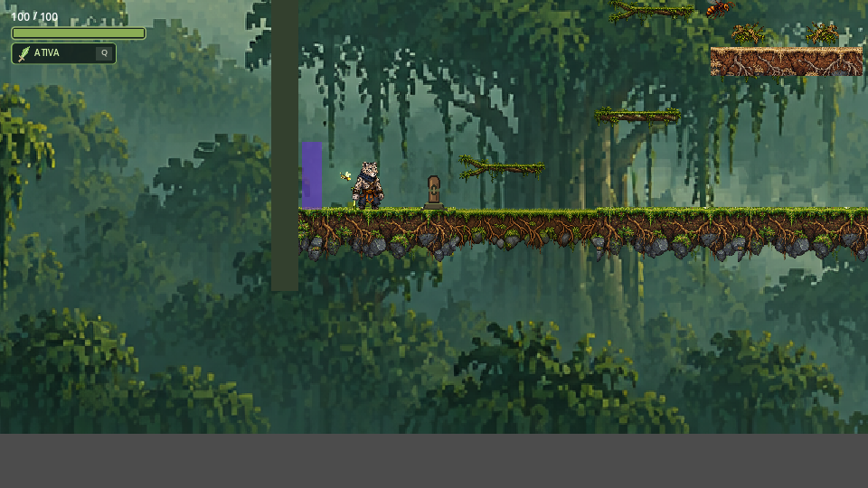 |  |

## Ataque do Korrag

Os dois primeiros quadros da animação `attack` tinham orientação oposta à do terceiro. A cena agora espelha apenas esses quadros na exibição, considerando para qual lado o Korrag encara. Os três quadros foram conferidos nas duas direções.

| Esquerda, quadro 1 | Esquerda, quadro 2 | Esquerda, quadro 3 |
| --- | --- | --- |
| 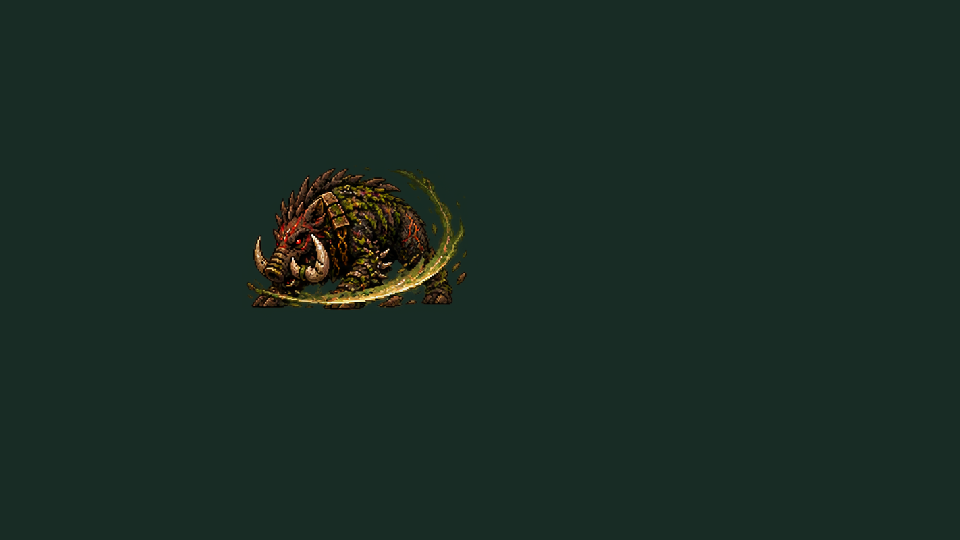 | 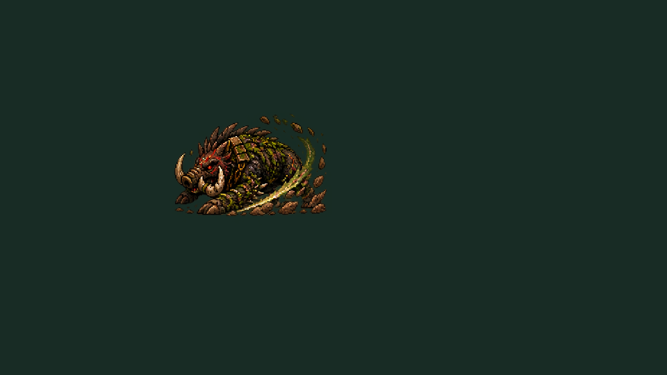 | 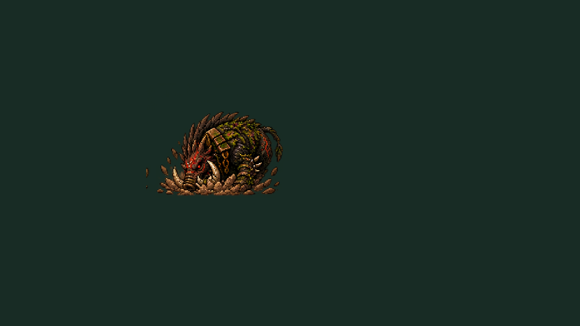 |

| Direita, quadro 1 | Direita, quadro 2 | Direita, quadro 3 |
| --- | --- | --- |
| 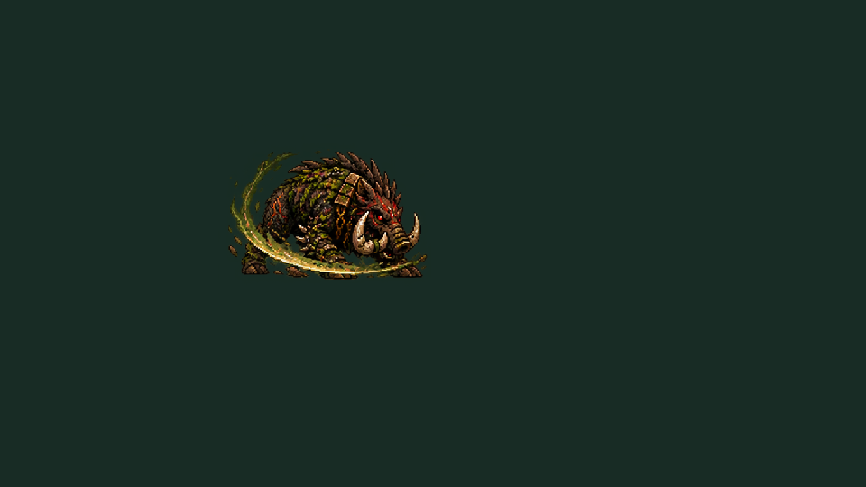 | 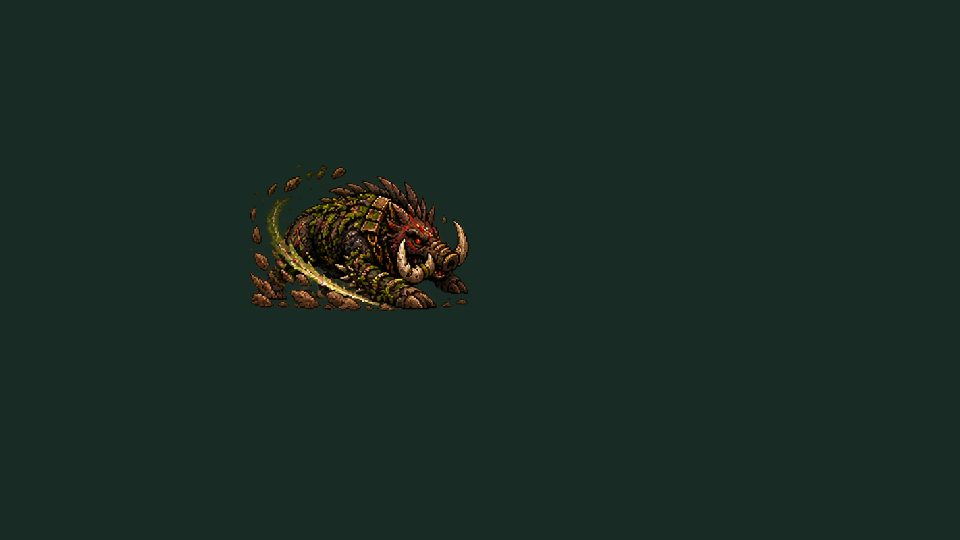 | 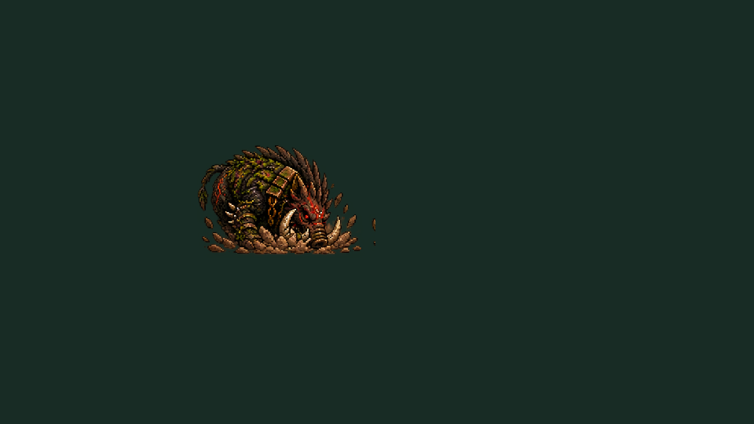 |

## Encerramento da demo

A tela usa a floresta e a tipografia do título. O fundo tem movimento sutil e passa do aspecto seco ao verde conforme 0, 1, 2 ou 3 áreas restauradas. A contagem, a mensagem e o botão inicial com foco foram conferidos em 1280×720 e 960×540.

| 0/3 | 1/3 | 2/3 | 3/3 |
| --- | --- | --- | --- |
| 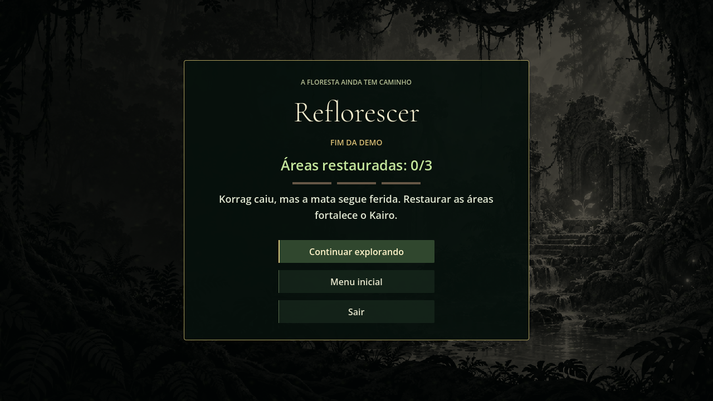 | 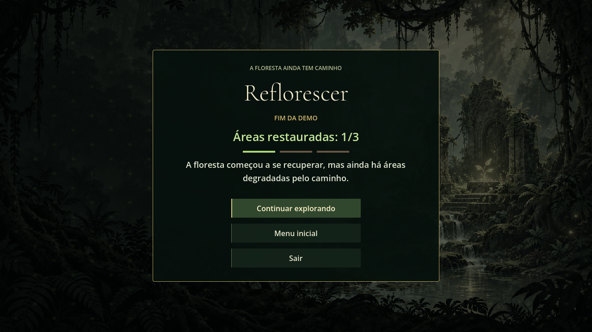 | 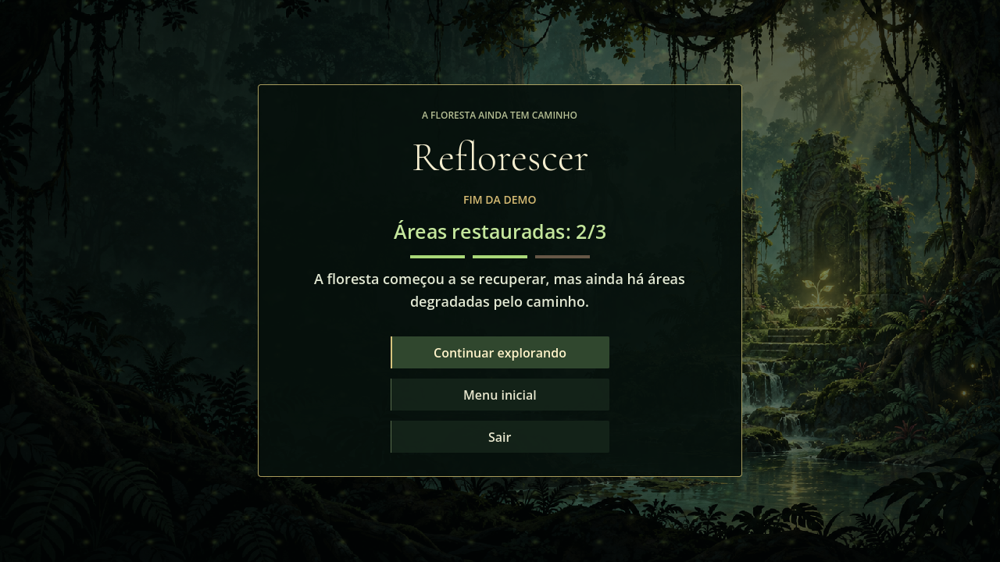 |  |

| 960×540, 0/3 | 960×540, 3/3 |
| --- | --- |
| 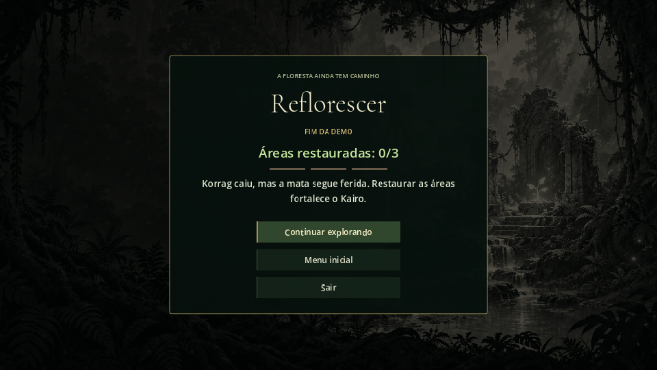 | 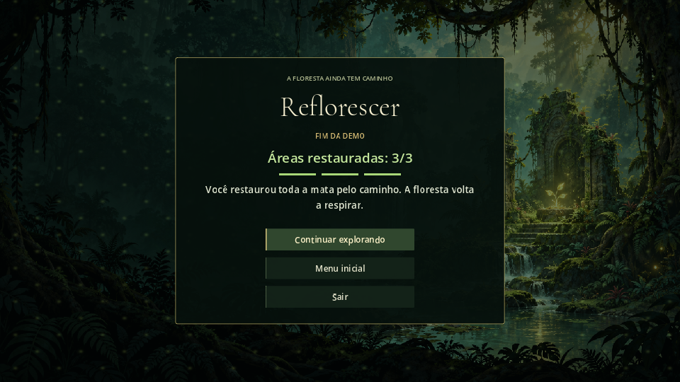 |

## O que falta conferir jogando

- Atravessar o checkpoint, sair, usar **Continuar** e observar o estado aceso sem salvar manualmente por cima de outro progresso.
- Ver o ataque do Korrag em movimento dos dois lados, inclusive na mudança entre o segundo e o terceiro quadro.
- Derrotar Korrag com diferentes contagens de áreas e conferir as três opções do encerramento.

Faísca fortalecida (A03-T2) e caminhos que crescem (A05-T6) continuam aguardando definição do grupo. Os playtests gerais de A07 também seguem pendentes.
