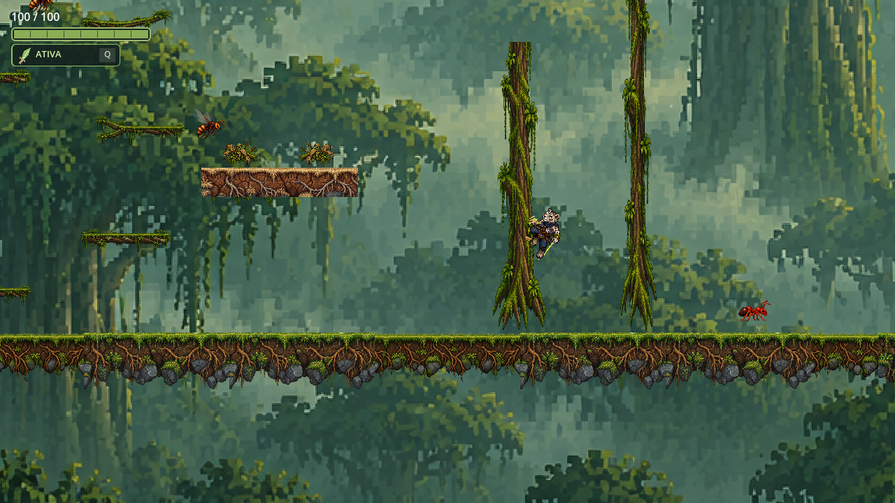

# Apoio na parede — revisão v4 (12/10/2026)

O apoio continua usando a pose aérea do Kairo, inclinada contra o tronco. A garra dianteira e o pé dobrado são os dois pontos reais de contato do sprite; os dois acompanham a inclinação e o espelhamento do personagem.

Durante o deslize, riscos claros saem da garra, o pé recebe a marca curta de pressão, e folhas com raspas de casca se soltam dos dois pontos e caem para o lado livre da parede. O efeito termina ao soltar o tronco ou saltar.

| Parede à direita | Parede à esquerda |
| --- | --- |
|  |  |

Validação: `MovementAnimationRuntimeCheck.tscn` passou nos dois lados, incluindo a posição dos dois pontos de contato, salto de saída e remoção completa do efeito.
